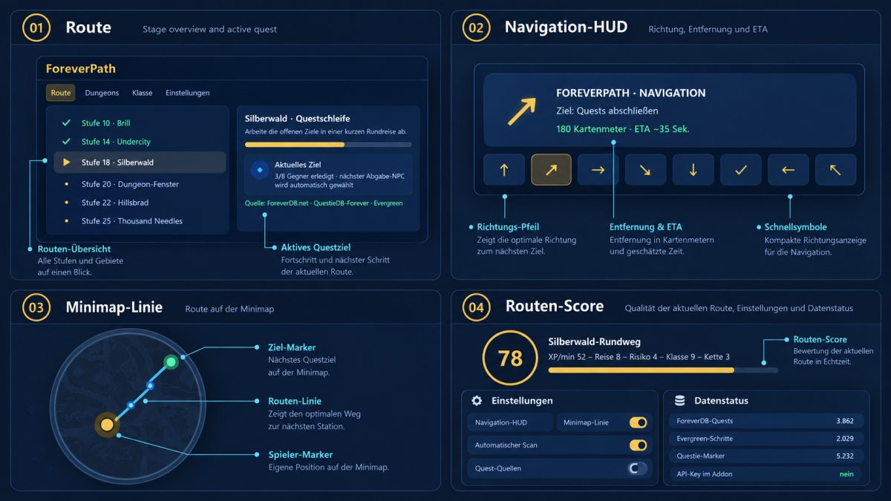

# ForeverPath

Eigenständiges Leveling- und Routen-Addon für **World of Warcraft: Forever**.

ForeverPath zeigt dir den nächsten sinnvollen Questschritt, setzt Wegpunkte, bewertet Alternativen und verfolgt deinen Fortschritt. Das Design und die Routenlogik sind eigenständig und enthalten keine RestedXP-Quelltexte, Grafiken, Texte oder geschützten Guide-Inhalte.

Die aktuelle Beta-Version `0.9.35-beta` enthält zusätzlich eine eigene Guide-Schicht für Forever-Routen: Questannahme, Ziele, Abgabe, Folgequests, Reise-/Versorgungsstopps und Klassenlehrer-Meilensteine erscheinen als getrennte, scrollbare Schritte. Aktive Questlog-Schritte bleiben vorrangig; fremder Addon-Code, geschützte Texte und geschützte Guide-Inhalte werden nicht kopiert. Dazu kommen der eigene Guide-Katalog mit automatischer Auswahl nach Fraktion/Volk/Klasse/Level, der Questlog-Tab, Fokussteuerung per Rechtsklick, questlogbasierte Schnellrouten, aktuelle-Zone-Filter, automatische Route-Recovery, Reiseplaner, Minimap- und Weltkarten-Navigation, **Gear & Rewards**, XP/h-Lernwerte und Streamer-Layouts.

Neu in `0.9.35-beta`: ForeverDB-Build-/Hotfix-Snapshots werden beim Extended-Import optional mitgeführt. Das Addon zeigt den Datenstand und die Hotfix-Frische transparent an. Questschritte zeigen im Detailfenster jetzt die eigene Reihenfolge **Annehmen → Questgeber → Ziele → Abgabe → Folgequest**, während der Tracker eine kurze, lesbare Zusammenfassung behält. Der Reiseplan ergänzt Distanz/ETA, sofern der Client echte Weltkoordinaten liefert. Zusätzlich enthält der Fehlerbericht den erkannten Forever-Client-Kompatibilitätsstatus.

Neu in `0.9.34-beta`: Das Tracker- und Guide-Fenster nutzt font-sichere Marker statt fehlerhafter Kästchen, trennt Schritt-/Zoneninformationen sauber und hat größere, zuverlässigere Klickflächen für Schließen, Einklappen und Guide-Auswahl. Über **Guide wechseln** öffnest du die eigene Guide-Auswahl. ForeverPath schlägt den passenden Weg automatisch vor, lässt aber auch andere Startzonen derselben Fraktion auswählen. Die Questlog-Schritte bleiben live und werden nicht durch allgemeine Guide-Hinweise ersetzt.

Neu in `0.9.32-beta`: Das Addon verwendet ein eigenes 64x64-TGA-Icon für die Addon-Liste und einen eigenen scharfen Navigationspfeil ohne generisches Blizzard-Symbol, doppelten Glow oder Panel-Hintergrund. Der Pfeil bleibt separat verschiebbar; Schritt, Entfernung/ETA und Zielname stehen kompakt darunter.

Neu in `0.9.27-beta`: Die XP-Vorschau ist ein eigenes verschiebbares HUD mit Ein/Aus-Schalter, Breite, Höhe, Skalierung und Sperre. Der Navigationspfeil ist ein kleines einzelnes Widget ohne zweiten Glow-Pfeil: Schritt, Entfernung/ETA und ein gekürztes Ziel stehen sauber unter dem Pfeil. Der Pfeil folgt weiterhin live der Blickrichtung und wird nicht von einem separaten oberen Navigationsfeld überlagert.

Neu in `0.9.28-beta`: Der Tracker beschreibt jetzt die konkrete Reihenfolge mit Annahmeort, Questgeber, Zielgebiet/Koordinaten, Abgabe-NPC und Folgequest. Zusätzlich wird der nächste Klassen- und Trainerstopp mit Stufe, Lernhinweis und Ort angezeigt. Nach dem Öffnen eines Trainerfensters listet ForeverPath die tatsächlich verfügbaren Fähigkeiten und den beobachteten Trainerort auf; ohne Scan bleibt es ausdrücklich eine Empfehlung.

Neu in `0.9.29-beta`: Der Ingame-Tracker hat jetzt einen echten Scrollbereich. Die aktuellen Anweisungen bleiben oben, darunter erscheinen weitere Folgequests und bis zu acht kommende Guide-Schritte. Mausrad scrollt, zukünftige Schritte können angeklickt werden und laden sofort als Fokus für Tracker und Pfeil.

Neu in `0.9.30-beta`: Die XP-Anzeige ist jetzt ein eigenes, dreizeiliges HUD. Oben stehen die Zeit auf dem aktuellen Level und die Sitzungszeit, in der Mitte aktuelle XP mit Level und Fortschrittsbalken, unten ETA, gemessene XP pro Stunde, abgeschlossene Quest-XP, Erholungsbonus und die XP aus dem Questlog. Breite, Höhe, Skalierung, Position und Sperre bleiben im Menü einstellbar. Die Anzeige verwendet ein eigenständiges Layout und keine RestedXP-Quelltexte oder geschützten Grafiken.

## UI-Skizzen

Die geplante ForeverPath-Oberfläche ist in vier Bereichen skizziert: Route, Navigation-HUD, Minimap-Linie sowie Routen-Score mit Einstellungen und Datenstatus.

<p align="center">
  
</p>

## Installation

1. Öffne auf GitHub die Repository-Seite und klicke auf **Code → Download ZIP**. Dadurch wird `LvL-Guide-main.zip` heruntergeladen.
2. Entpacke `LvL-Guide-main.zip` zunächst. Darin liegt die Datei `ForeverPath.zip`.
3. Öffne/entpacke jetzt auch `ForeverPath.zip`. Erst darin liegt der eigentliche Ordner `ForeverPath` mit der Datei `ForeverPath.toc`.
4. Kopiere den kompletten Ordner `ForeverPath` nach:

   ```text
   <WoW-Forever-Installationsordner>/Interface/AddOns/
   ```

   Danach muss die Datei `ForeverPath.toc` direkt hier liegen:

   ```text
   .../Interface/AddOns/ForeverPath/ForeverPath.toc
   ```

5. Starte WoW Forever und öffne die Addon-Auswahl am Charakterbildschirm.
6. Aktiviere **ForeverPath**. Falls der Client es anbietet, kannst du „Veraltete Addons laden“ aktivieren.
7. Im Spiel findest du das verschiebbare ForeverPath-Symbol an der Minimap. Linksklick öffnet das Menü, Ziehen verschiebt das Symbol.

**Wichtig:** Verwende den Installationsordner des Forever-Clients, nicht den Retail- oder Classic-Ordner. Der konkrete Ordnername kann je nach Battle.net-Version abweichen; entscheidend ist, dass darin der Forever-Client und anschließend `Interface\AddOns` liegen. Am Ende darf der Pfad nicht doppelt verschachtelt sein. Falsch wäre zum Beispiel `AddOns/ForeverPath.zip/ForeverPath` oder `AddOns/ForeverPath/ForeverPath/ForeverPath.toc`.

## Bedienung im Spiel

- **Minimap-Symbol:** Menü öffnen, verschieben oder per Rechtsklick Route analysieren
- **Tracker:** zeigt aktuellen Schritt, Questziel, Fortschritt, Score, XP/h und Tode
- **Navigations-HUD:** Richtung, Zielart, Entfernung und geschätzte Reisezeit
- **Kompakter Richtungspfeil:** einzelner sauberer Pfeil, Schritt-/Entfernungszeile und Zielname; frei verschiebbar und mit dem UI sperrbar
- **Detaillierte Schrittanweisung:** Quest annehmen, mit welchem NPC sprechen, welche Ziele im Gebiet erledigen, wo abgeben, welche Folgequest annehmen und welcher Klassen-/Trainerstopp als Nächstes ansteht
- **Scrollbarer Tracker:** weitere Folgequests und kommende Routen-/Dungeon-/Trainer-Schritte per Mausrad anzeigen und anklicken
- **EP-Navigationsmodus:** passende Mob-Zielpunkte werden als Quest-/EP-Ziel priorisiert; die Schätzung wird aus beobachteten XP-Gewinnen verbessert
- **Weltkarte:** Linie zum aktuellen Ziel und kommende Routenpunkte
- **Reiseplan:** sortiert Fuß/Reittier, Flugpunkt, Schiff/Zeppelin, Hearthstone, Klassenreise und Zonenwechsel; unbestätigte Transportwege werden klar markiert
- **Quest-XP-Projektion:** fertige Questbelohnungen werden als Vorschau über der Blizzard-XP-Leiste angezeigt; „LEVEL UP READY!“ wird nur bei ausreichender Summe eingeblendet
- Die XP-Vorschau kann im Menü ausgeblendet, per Drag verschoben, in Breite/Höhe/Skalierung angepasst und gesperrt werden
- **Dynamische TTG:** XP/h wird als gewichteter gleitender Wert über bis zu zehn Minuten berechnet und getrennt nach Kills, Quests und Reisezeit ausgewiesen
- **Tooltip-Mobwert:** Mouseover-/Target-Tooltips zeigen geschätzte Mob-XP, Level-Prozent und Kills bis zum Level-Up
- **Layer-Hinweis:** lokale Überfarm-Indikatoren und optionale ForeverGuild-Layerdaten führen zu einem Wechselvorschlag; das Addon wechselt Layer niemals selbstständig
- **Route sync:** findet nach einem übersprungenen Schritt automatisch einen passenden Schritt in der aktuellen Zone
- **Jetzt analysieren:** startet den Quest- und Routen-Scan sofort
- Automatischer Scan beim Login und anschließend alle fünf Minuten
- Quest-ID-Verknüpfung mit NPC, Ziel, Abgabe, Folgequest und Live-Objektiven
- Tracker-Fortschrittsbalken, Restziele, Einklappen und Skalierung
- automatische Route-Recovery, erledigte-Schritte-Überspringen und Score-Alternativen
- Trainer-, Berufs-, Gasthof-, Flugpunkt-, Reparatur- und Hauptstadtstopp-Empfehlungen
- Gear-Profile für Auto, DPS, Tank und Heiler sowie Questbelohnungs-Vergleich
- Gear-Profile für Auto, DPS, Tank, Heiler und Solo sowie Prozentvergleich der Questbelohnungen
- sichere Auto-Questaktion für die passende Annahme und das Öffnen der Abgabe; die Belohnung bleibt immer manuell auswählbar und bestätigbar
- gespeicherte Fensterpositionen, UI-Sperre, Transparenz, Schriftgröße und Minimalmodus
- Fehlerbericht-Export für Discord und Datenstatus mit ForeverDB-Build
- Quest-XP-API mit verstecktem Tooltip-Fallback, falls der Client keinen Rewardwert liefert

Die Bedienung läuft vollständig über das verschiebbare Minimap-Symbol, den Tracker und die sichtbaren Buttons im Menü. Chatbefehle sind nicht erforderlich.

## Was das Addon bewertet

Die Empfehlung berücksichtigt unter anderem:

- XP pro Minute
- Reise-, Kampf- und Risikokosten
- Gruppenwartezeit und Rollenbonus
- Klassen- und Questkettenbonus
- Folgequestwert
- Ausrüstungszustand und mögliche Questbelohnungs-Upgrades
- Dungeon-Level, Gruppengröße, ForeverDB-Status und heuristischen Gear-/Loot-Bedarf
- aktuelle Zone und bereits erledigte Schritte

XP/h, Sessionzeit, Quest-/Kill-XP, Reisezeit und Todesfälle werden lokal aus deiner tatsächlichen Spielsitzung erfasst. Mob-XP und Layer-Druck bleiben ausdrücklich Schätzungen, bis der Client oder eine optionale ForeverGuild-Schnittstelle bestätigte Daten liefert.

## Kompatibilität

Der aktuelle Build nutzt `Interface: 16001`, die derzeit dokumentierte Forever-Schnittstelle. Die Interface-Zeile und das Addon müssen nach jedem Client-Update im echten Spiel geprüft werden. XP- und Layer-Funktionen sind defensiv implementiert und fallen bei fehlenden APIs auf sichtbare Schätzungen zurück.

Ein echter Client-Test ist immer wichtiger als die Versionsnummer: Wenn das Addon nicht erscheint, zuerst den Installationspfad und die Ordnerstruktur prüfen.

## Datenquellen und API-Key

Das Addon enthält einen statischen, dokumentierten Datenstand. Es fragt ForeverDB im Spiel nicht live ab. Der ForeverDB-API-Key ist **nicht** in der ZIP und wird nicht benötigt, um das Addon zu installieren.

Enthaltene öffentliche Quellen:

- [ForeverDB API](https://foreverdb.net/developers) für Quest-, Dungeon-, Klassen-, Berufs-, Zonen- und bestätigte Änderungsdaten
- [QuestieDB-Forever / Forever Quest Pins](https://github.com/TylerAkins/forever-quest-markers)
- [Evergreen for WoW Forever](https://github.com/Dj2Swagittarius/evergreen-wow-forever)

Die vollständigen Attributionen, Lizenztexte und Import-Hinweise liegen im Addon unter `ExternalData/`. Die sichtbare Quellenangabe `Data from ForeverDB.net (https://foreverdb.net)` bleibt im Menü und Tracker erhalten.

## Daten aktualisieren

Für Entwickler liegt unter [`DATA-UPDATE.md`](./DATA-UPDATE.md) die Anleitung für neue lokale ForeverDB-Daten. Der Importer [`tools/import_foreverdb.py`](./tools/import_foreverdb.py) liest den persönlichen Schlüssel ausschließlich aus `FOREVERDB_API_KEY` und schreibt ihn nicht in Dateien. Der optionale Aufruf `python tools/import_foreverdb.py --extended` ergänzt weitere öffentliche Endpoint-Daten, Dungeon-Details sowie kompakte Item- und Spell-Daten.

Bitte niemals einen API-Key committen oder in die Addon-ZIP packen. Bei versehentlicher Offenlegung den Schlüssel auf der ForeverDB-Developer-Seite widerrufen und einen neuen erstellen.

## Changelog

Die Versionshistorie steht in [`CHANGELOG.md`](./CHANGELOG.md).

## Kontakt

Fragen, Fehlerberichte und Vorschläge gerne über Discord:

**Discord: `pacco1234`**

Bitte bei Fehlern möglichst Client-Version, Screenshot, reproduzierbare Schritte und den betroffenen Charakter-/Routenmodus mitschicken.

## Lizenzhinweis

ForeverPath wird als Community-Projekt bereitgestellt. Die jeweiligen offenen Datenquellen und deren Lizenzbedingungen bleiben unter `ExternalData/` dokumentiert. World of Warcraft und seine Inhalte gehören Blizzard Entertainment, Inc.
